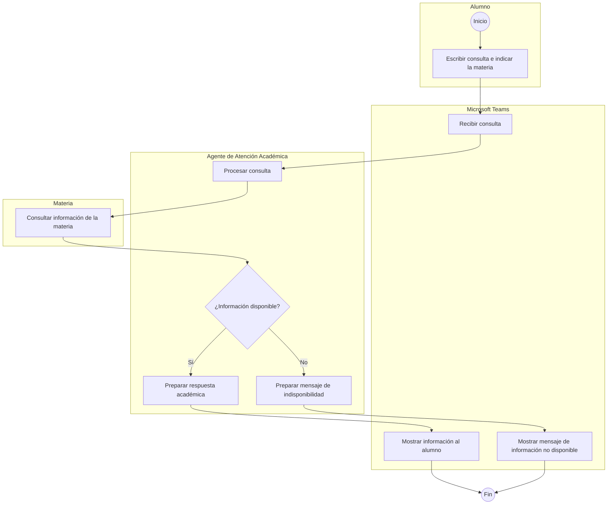

# Diagrama de actividad UML

**Proyecto:** Agente de Atención Académica en Copilot  
**Materia:** SIS3407 – Ingeniería de Software I

## 1. Caso de uso representado

**Consultar información de una materia.**

El diagrama representa el flujo de actividades que ocurre cuando un alumno solicita información sobre una materia mediante el Agente de Atención Académica en Microsoft Teams.

## 2. Diagrama de actividad

## 3. Descripción del flujo

1. El alumno inicia el proceso escribiendo una consulta e indicando la materia de su interés.
2. Microsoft Teams recibe la consulta y la envía al Agente de Atención Académica.
3. El agente procesa la solicitud y consulta la información correspondiente a la materia.
4. Se verifica si la información solicitada está disponible.
5. Si la información está disponible, el agente prepara una respuesta académica y Teams la muestra al alumno.
6. Si la información no está disponible, el agente prepara un mensaje de indisponibilidad y Teams lo presenta al alumno.
7. El proceso finaliza después de mostrar la respuesta correspondiente.

## 4. Interpretación

El diagrama permite visualizar las actividades y responsabilidades de cada participante durante una consulta académica. También representa las dos posibles rutas del proceso, dependiendo de la disponibilidad de la información solicitada.

Este flujo corresponde al caso de uso «Consultar información de una materia», definido previamente en el modelo de casos de uso del proyecto.
