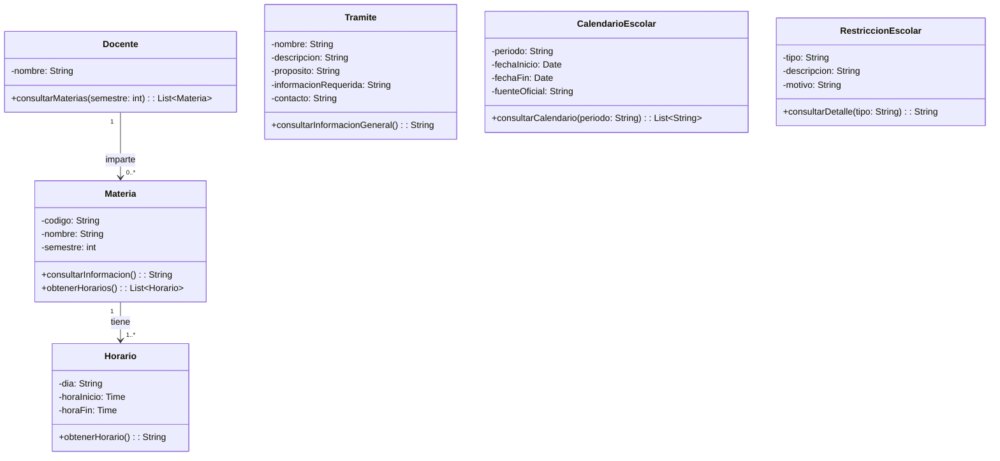
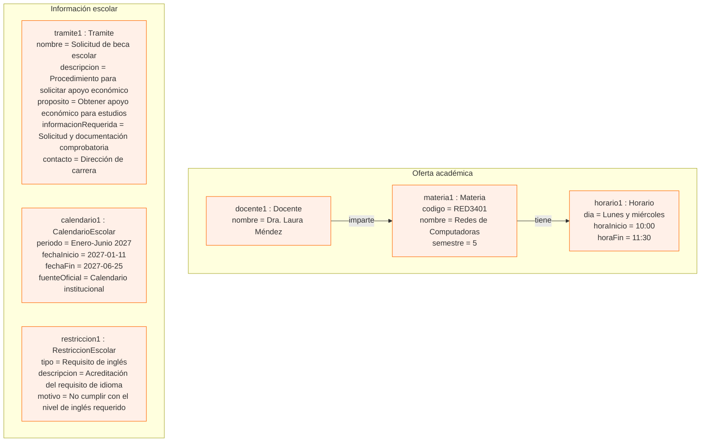

# Actividad: Diagrama de clases y diagrama de objetos

**Proyecto:** Agente de Atención Académica en Copilot  
**Materia:** SIS3407 – Ingeniería de Software I

---

## 1. Diagrama de clases UML

A partir de las seis clases candidatas identificadas en la actividad anterior, se construye el diagrama de clases UML, definiendo sus atributos, tipos de datos, operaciones, parámetros y niveles de visibilidad.

### 1.1. Atributos y operaciones

| Clase | Atributos | Operaciones |
|---|---|---|
| Materia | codigo: String, nombre: String, semestre: int | consultarInformacion(): String, obtenerHorarios(): List<Horario> |
| Docente | nombre: String | consultarMaterias(semestre: int): List<Materia> |
| Horario | dia: String, horaInicio: Time, horaFin: Time | obtenerHorario(): String |
| Tramite | nombre: String, descripcion: String, proposito: String, informacionRequerida: String, contacto: String | consultarInformacionGeneral(): String |
| CalendarioEscolar | periodo: String, fechaInicio: Date, fechaFin: Date, fuenteOficial: String | consultarCalendario(periodo: String): List<String> |
| RestriccionEscolar | tipo: String, descripcion: String, motivo: String | consultarDetalle(tipo: String): String |

Los atributos tendrán visibilidad privada (`-`) y las operaciones visibilidad pública (`+`), aplicando el principio de encapsulamiento.

### 1.2. Relaciones y multiplicidades

Se establecen dos relaciones de asociación entre las clases:

| Relación | Multiplicidad | Justificación |
|---|---|---|
| Docente – Materia | Docente (1) / Materia (0..*) | Un docente puede impartir ninguna o varias materias, mientras que cada materia tiene asignado un docente en el periodo académico representado. |
| Materia – Horario | Materia (1) / Horario (1..*) | Una materia tiene uno o varios horarios, y cada horario corresponde a una sola materia. |

Las multiplicidades representan supuestos iniciales del modelo que deberán validarse con la Dirección de carrera, especialmente en lo relacionado con los grupos y docentes asignados a cada materia.

No se utiliza composición porque ninguna de las clases identificadas depende de la existencia de otra para sobrevivir. Tampoco se utiliza herencia ni agregación, ya que no se identificaron relaciones que justifiquen su aplicación.

### 1.3. Código Mermaid: diagrama de clases

### 1.4. Interpretación del diagrama

- **Materia:** almacena información que permite identificar las asignaturas disponibles.
- **Docente:** contiene información del profesor y permite consultar las materias que imparte.
- **Horario:** almacena los días y horas correspondientes a una materia.
- **Tramite:** concentra la información necesaria para orientar a los alumnos sobre los procedimientos escolares.
- **CalendarioEscolar:** almacena los periodos y fechas académicas oficiales.
- **RestriccionEscolar:** contiene información sobre las restricciones académicas y sus motivos.

Las relaciones permiten representar la asignación de docentes a materias y la organización de los horarios académicos.

---

## 2. Diagrama de objetos

Para comprobar que el diagrama de clases puede representar un escenario real, se construye un caso concreto utilizando datos ficticios, pero realistas.

### 2.1. Descripción del caso

Se plantea el siguiente escenario:

Un alumno consulta mediante el Agente de Atención Académica la oferta de materias correspondiente al semestre enero-junio de 2027. El agente proporciona información sobre una materia, el docente que la imparte y su horario.

Además, el alumno puede consultar información sobre un trámite escolar, el calendario académico y una restricción relacionada con los requisitos de inglés.

### 2.2. Objetos y valores asignados

Los siguientes objetos representan instancias de las seis clases definidas anteriormente.

| Objeto | Clase | Valores de sus atributos |
|---|---|---|
| materia1 | Materia | codigo = "RED3401", nombre = "Redes de Computadoras", semestre = 5 |
| docente1 | Docente | nombre = "Dra. Laura Méndez" |
| horario1 | Horario | dia = "Lunes y miércoles", horaInicio = 10:00, horaFin = 11:30 |
| tramite1 | Tramite | nombre = "Solicitud de beca escolar", descripcion = "Procedimiento para solicitar apoyo económico", proposito = "Obtener apoyo económico para estudios", informacionRequerida = "Solicitud y documentación comprobatoria", contacto = "Dirección de carrera" |
| calendario1 | CalendarioEscolar | periodo = "Enero-Junio 2027", fechaInicio = "2027-01-11", fechaFin = "2027-06-25", fuenteOficial = "Calendario institucional" |
| restriccion1 | RestriccionEscolar | tipo = "Requisito de inglés", descripcion = "Acreditación del requisito de idioma", motivo = "No cumplir con el nivel de inglés requerido" |

**Nota:** Los nombres, fechas y datos académicos son completamente ilustrativos. No representan información oficial de la Universidad Anáhuac Querétaro.

### 2.3. Código Mermaid: diagrama de objetos

Mermaid no cuenta con una sintaxis nativa específica para diagramas de objetos UML. Por ello, se utiliza `flowchart` para representar visualmente las instancias, sus atributos y las relaciones entre ellas.

### 2.4. Interpretación del diagrama de objetos

El diagrama representa seis instancias correspondientes a las seis clases del modelo.

Las relaciones entre los objetos respetan las asociaciones establecidas en el diagrama de clases:

- `docente1` imparte `materia1`.
- `materia1` tiene asociado `horario1`.
- `tramite1`, `calendario1` y `restriccion1` representan información académica independiente dentro del modelo actual.

---

## 3. Comprobación del modelo

Después de construir ambos diagramas, se verifica que las instancias representadas respeten la estructura definida en el diagrama de clases.

| Criterio de comprobación | Resultado |
|---|---|
| Los seis objetos corresponden a clases definidas en el diagrama de clases. | Correcto |
| Los atributos representados pertenecen a sus respectivas clases. | Correcto |
| Los objetos contienen valores para todos los atributos definidos. | Correcto |
| El docente está relacionado con una materia. | Correcto |
| La materia tiene al menos un horario asociado. | Correcto |
| Las relaciones respetan las multiplicidades establecidas. | Correcto |
| Se agregaron relaciones que no están justificadas en el modelo. | No |

### 3.1. Validación de multiplicidades

**Relación Docente – Materia**

- `docente1` representa un docente asociado con una materia.
- La relación permite que un docente imparta varias materias.
- Cada materia tiene asignado exactamente un docente en el modelo propuesto.

**Relación Materia – Horario**

- `materia1` tiene asociado un horario.
- La relación permite que una materia tenga uno o varios horarios.
- Cada horario corresponde a una sola materia.

Por lo tanto, el caso concreto cumple con las multiplicidades definidas en el diagrama de clases.

---

## 4. Justificación del diseño

El diagrama de clases representa seis entidades principales del dominio académico del Agente de Atención Académica en Copilot: Materia, Docente, Horario, Tramite, CalendarioEscolar y RestriccionEscolar.

Se establecieron relaciones de asociación entre Docente y Materia, así como entre Materia y Horario, debido a que representan vínculos estables dentro de la información académica.

No se utilizaron relaciones de composición porque ninguna de las clases identificadas requiere que otra entidad desaparezca obligatoriamente cuando ella deja de existir. Tampoco se utilizó herencia, ya que no se identificaron clases especializadas que compartan una estructura común.

El diagrama de objetos permitió comprobar que las clases pueden representar un escenario concreto de consulta académica, utilizando instancias y valores que respetan los atributos y multiplicidades definidos.

De esta manera, ambos diagramas mantienen coherencia entre sí y constituyen una base para continuar con el diseño orientado a objetos del agente.

---

## Conclusión

Mediante la elaboración del diagrama de clases se definieron las seis clases candidatas del Agente de Atención Académica en Copilot, especificando sus atributos, tipos de datos, operaciones y niveles de visibilidad.

También se establecieron las relaciones de asociación y sus respectivas multiplicidades, evitando utilizar relaciones de composición, agregación o herencia sin una justificación dentro del dominio del sistema.

Posteriormente, se elaboró un diagrama de objetos con información ficticia para comprobar que el modelo puede representar un escenario realista de consulta académica.

La validación permitió verificar que las instancias respetan la estructura, los atributos y las relaciones definidas en el diagrama de clases.

Este trabajo constituye una base para continuar con el diseño orientado a objetos y desarrollar los siguientes diagramas UML del proyecto.
