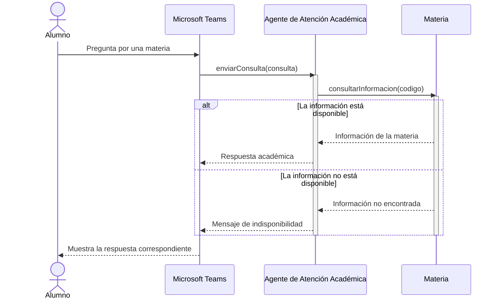

# Diagrama de Secuencia

### 1. Caso de uso seleccionado

**Consultar información de una materia**

- Actor principal: Alumno.
- Sistema: Agente de Atención Académica en Copilot.
- Interfaz: Microsoft Teams.
- Clase involucrada: Materia.

Se seleccionó este caso de uso porque representa una de las funcionalidades principales del agente: permitir que los alumnos consulten información académica de las materias.

### 2. Diagrama de secuencia

El siguiente diagrama representa la interacción entre el alumno, Microsoft Teams, el agente y la clase Materia. Se contempla tanto el escenario en el que la información está disponible como aquel en el que no se encuentra.

### 3. Participantes y responsabilidades

| Participante | Responsabilidad |
|---|---|
| Alumno | Realiza la consulta de una materia. |
| Microsoft Teams | Recibe y muestra los mensajes del alumno. |
| Agente de Atención Académica | Procesa la consulta y prepara la respuesta. |
| Materia | Proporciona la información académica solicitada. |

### 4. Revisión de consistencia con el diagrama de clases

Se revisó la operación que recibe la clase Materia en el diagrama de secuencia y se comparó con las operaciones existentes en el diagrama de clases.

La clase Materia ya cuenta con la siguiente operación:

`consultarInformacion(): String`

Sin embargo, se identificó que es necesario considerar un parámetro que permita identificar la materia específica que desea consultar el alumno.

**Modificación propuesta:**

`consultarInformacion(codigo: String): String`

Esta modificación permitirá relacionar la consulta con el código de la materia correspondiente.

### 5. Trazabilidad con el diagrama de casos de uso

El escenario representado corresponde al caso de uso **Consultar información de una materia**, incluido en el diagrama de casos de uso de la Unidad 2.

Por lo tanto, el diagrama de secuencia mantiene la trazabilidad con una funcionalidad previamente definida para el sistema.

### 6. Conclusión

La elaboración del diagrama de secuencia permitió representar el comportamiento del agente durante una consulta académica, identificando el orden de las interacciones entre sus participantes.

Además, permitió detectar una posible mejora en la operación de la clase Materia, demostrando la importancia de revisar la consistencia entre los diagramas estructurales y de comportamiento.
