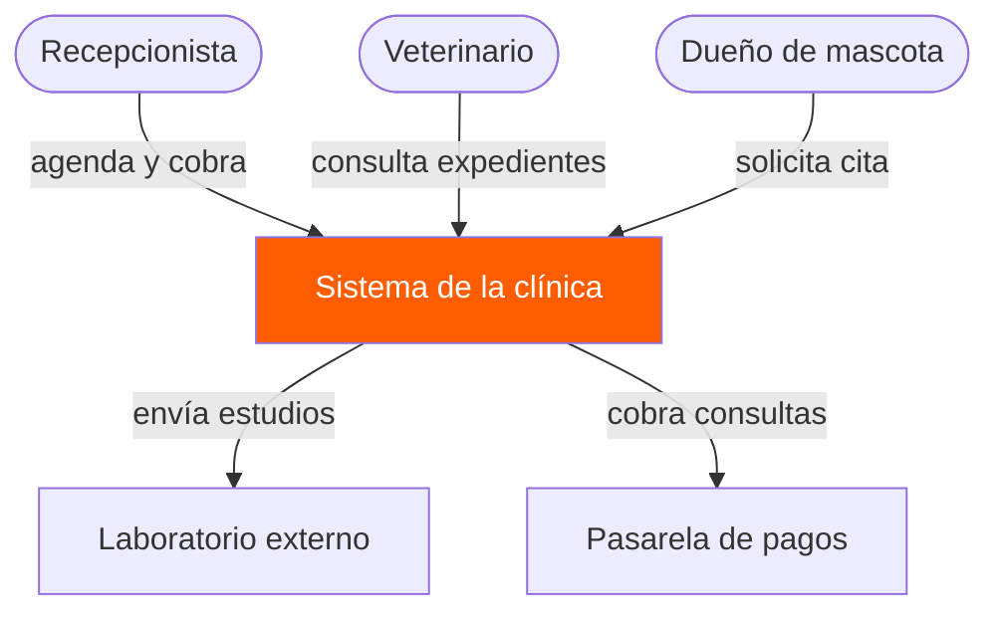
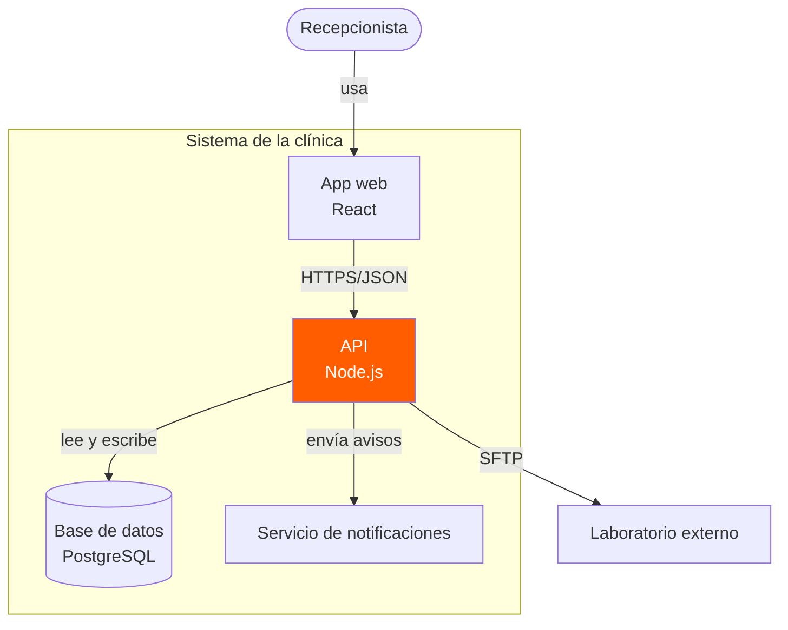
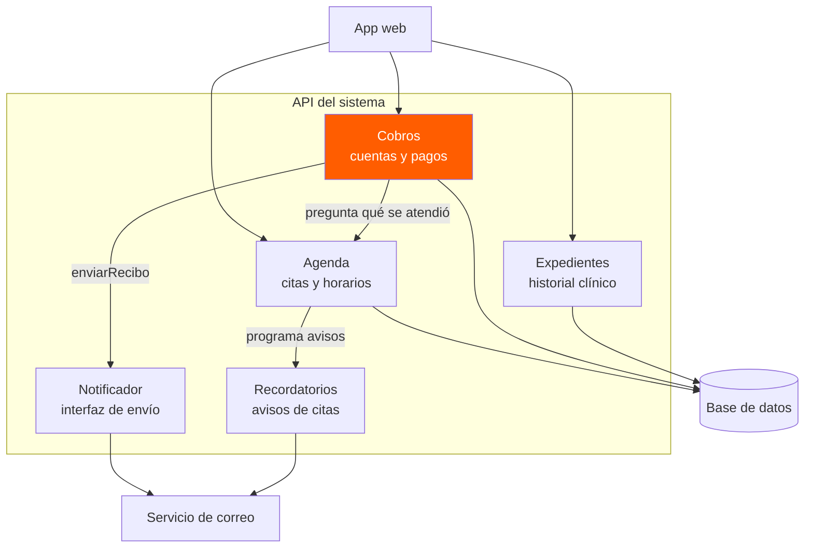
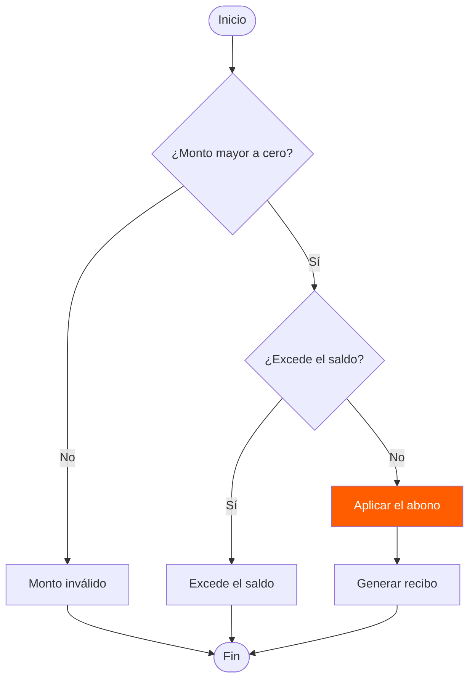
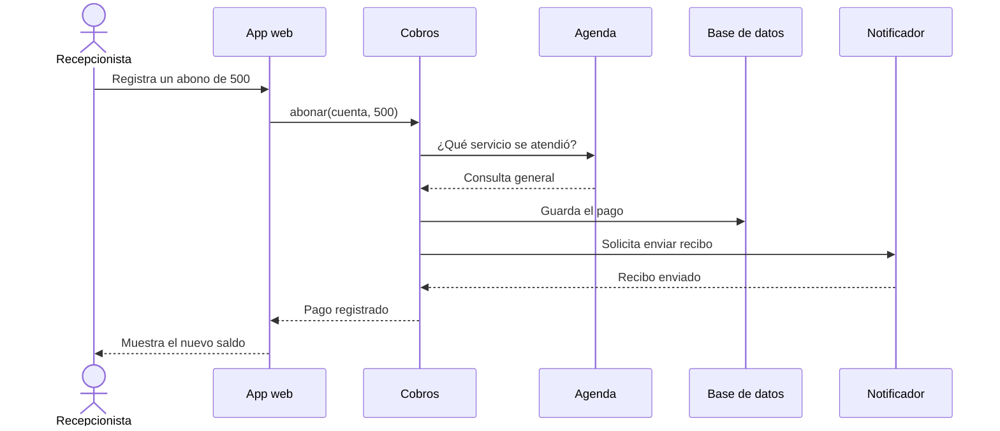
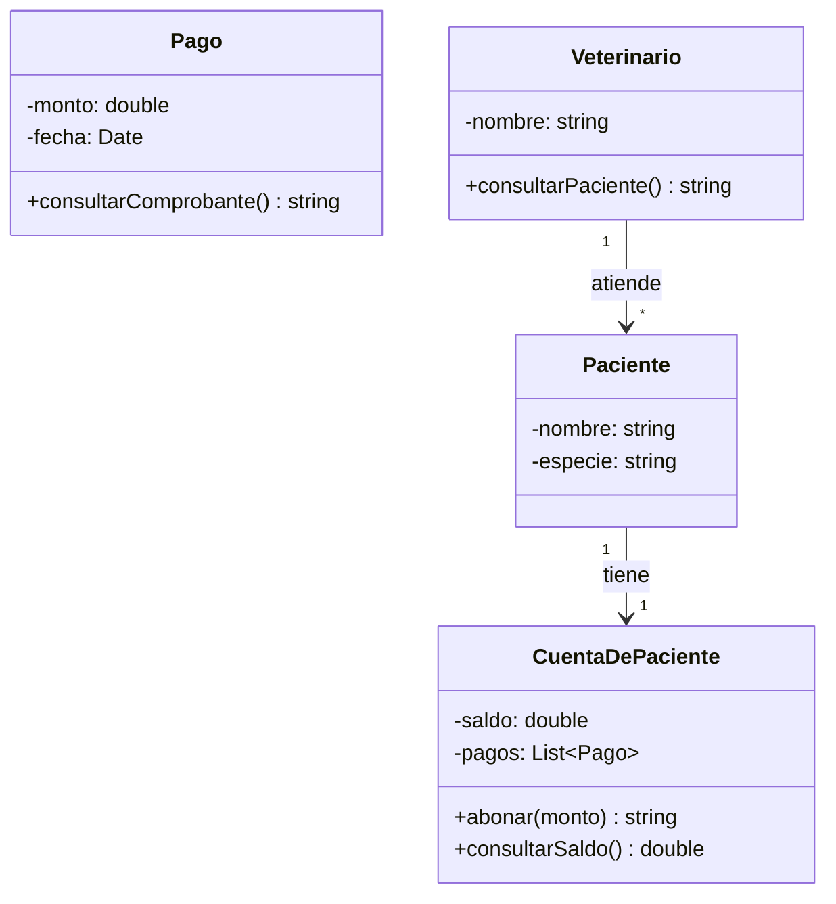
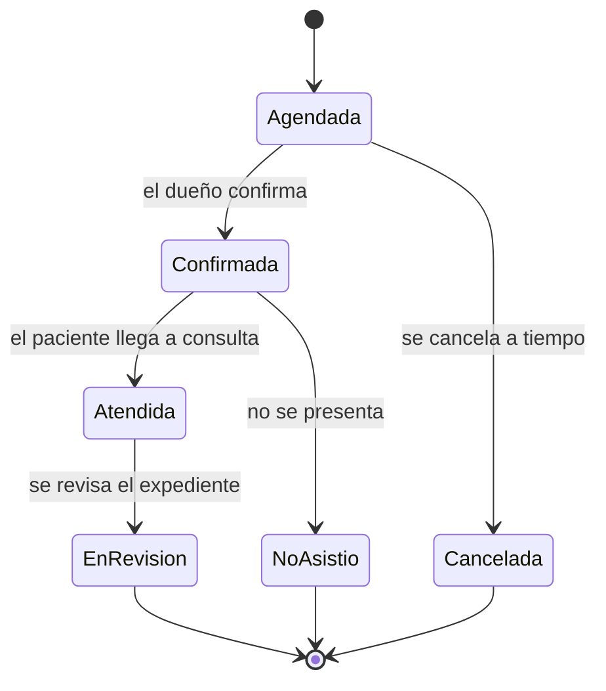
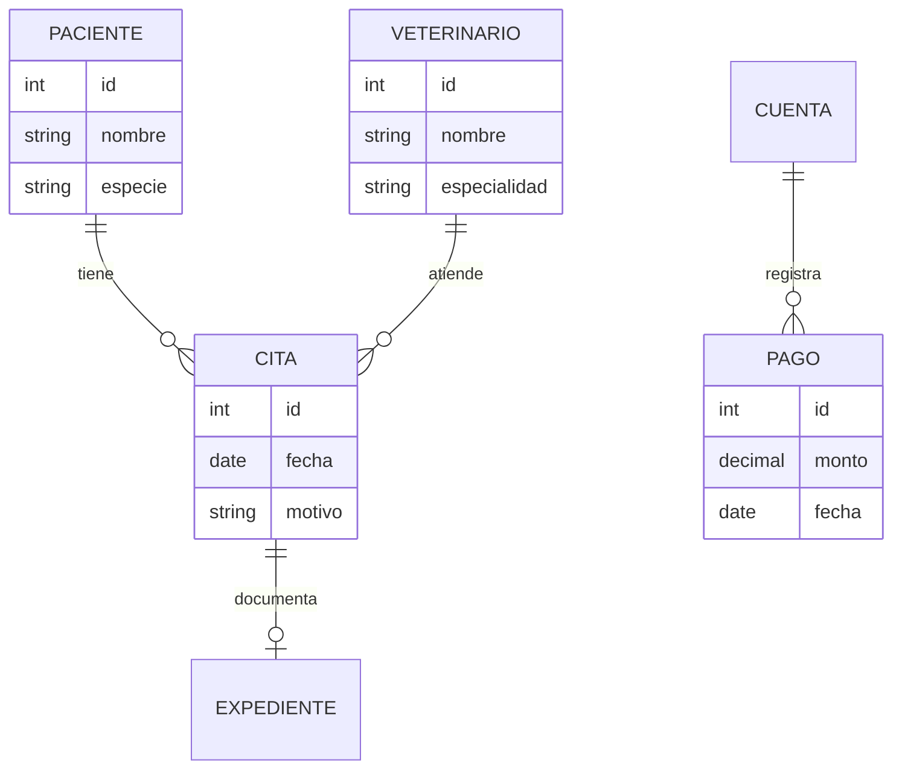

# Actividad: Diagramas con Mermaid

## 1. Diagrama de contexto

**Cambios realizados:**
1. Se agregó una caja: `Dueño de mascota`.
2. Se agregó la etiqueta `solicita cita` a la nueva relación.
3. Se eliminó la flecha `Veterinario --> Sistema de la clínica` para mostrar una versión alternativa en la que el veterinario no interactúa directamente con el sistema.

## 2. Diagrama de contenedores

**Cambios realizados:**
1. Se agregó el contenedor `Servicio de notificaciones`.
2. Se agregó la etiqueta `envía avisos` a la relación entre la API y el nuevo contenedor.
3. Se eliminó la flecha `API --> Laboratorio externo` para mostrar una versión alternativa sin la comunicación directa con el laboratorio.

## 3. Diagrama de componentes

**Cambios realizados:**
1. Se agregó el componente `Recordatorios`.
2. Se cambió la etiqueta `pregunta que se atendió` por `pregunta qué se atendió`.
3. Se eliminó la flecha `Expedientes --> Base de datos` para mostrar una versión alternativa sin esa conexión directa.

## 4. Diagrama de flujo con decisiones

**Cambios realizados:**
1. Se agregó la caja `Generar recibo`.
2. Se modificó la etiqueta de la decisión a `¿Monto mayor a cero?`.
3. Se eliminó la flecha directa de `apl` a `fin`.

## 5. Diagrama de secuencia

**Cambios realizados:**
1. Se agregó el participante `Notificador`.
2. Se cambió la etiqueta del mensaje a `¿Qué servicio se atendió?`.
3. Se eliminó la respuesta `BD-->>Cob: Listo`.

## 6. Diagrama de clases

**Cambios realizados:**
1. Se agregó la clase `Veterinario`.
2. Se agregó la relación entre `Veterinario` y `Paciente`, con la etiqueta `atiende`.
3. Se eliminó la relación entre `CuentaDePaciente` y `Pago`.

## 7. Diagrama de estados

**Cambios realizados:**
1. Se agregó el estado `EnRevision`.
2. Se cambió la etiqueta a `el paciente llega a consulta`.
3. Se eliminó la transición directa `Atendida --> [*]` para que el proceso pase por `EnRevision`.

## 8. Diagrama entidad-relación

**Cambios realizados:**
1. Se agregó la entidad `VETERINARIO`.
2. Se cambió la etiqueta de la relación entre `CITA` y `EXPEDIENTE` de `genera` a `documenta`.
3. Se eliminó la relación entre `PACIENTE` y `CUENTA`.
