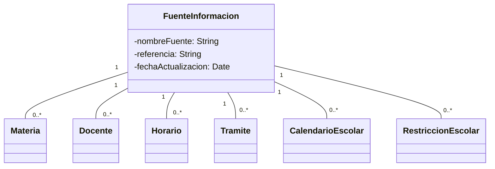

# AI-001: Identificación de la fuente y fecha de actualización de información académica

## 1. Datos generales

- **Solicitud relacionada:** SC-001 – Identificación de la fuente y fecha de actualización de información académica.
- **Solicitante:** Julián Guerrero Martínez
- **Responsable del análisis:** Dupla de revisión.
- **Fecha de análisis:** 13 de noviembre de 2026.
- **Tipo de cambio:** Perfectivo.
- **Prioridad:** Media.
- **Estado:** Propuesta de aceptación.

## 2. Descripción del cambio solicitado

Se propone que el Agente de Atención Académica en Copilot muestre la fuente institucional y la fecha de última actualización de la información proporcionada al alumno, siempre que estos datos estén disponibles.

Esto permitirá que los alumnos conozcan la procedencia de la información y tengan una referencia sobre su vigencia al consultar materias, horarios, trámites, calendario escolar y restricciones académicas.

Cuando no se cuente con una fecha de actualización, el agente deberá indicar que no es posible confirmar cuándo fue actualizada la información.

## 3. Análisis de impacto

### 3.1. Impacto directo

| Elemento del proyecto | Impacto identificado |
|---|---|
| Requerimientos funcionales (Unidad 2) | Se agrega el requisito de mostrar la fuente institucional y la fecha de actualización cuando estén disponibles. |
| Casos de uso (Unidad 2) | Se amplían los casos de consulta de materias, horarios, trámites, calendario y restricciones para incluir los datos de procedencia y actualización. |
| Diagrama de clases (Unidad 4) | Se propone agregar la clase `FuenteInformacion`, encargada de almacenar los datos de procedencia y actualización. |
| Diagrama de secuencia (Unidad 4) | Se modifica la respuesta del agente para incluir la información solicitada junto con su fuente y fecha de actualización. |
| Base de conocimiento (Unidad 3) | Se requiere incorporar los campos correspondientes a la fuente y fecha de actualización de los registros académicos. |
| Diagrama de componentes (Unidad 3) | Se actualizan las responsabilidades de los módulos Información académica, Trámites y bajas, y Validación y administración. |

### 3.2. Impacto indirecto

| Elemento del proyecto | Impacto identificado |
|---|---|
| Arquitectura monolítica modular | No requiere cambios en la arquitectura establecida. |
| Diagrama C4 de contexto | No presenta cambios, ya que los actores y el propósito general del sistema permanecen iguales. |
| Diagrama C4 de contenedores | No requiere agregar contenedores; se conserva la base de conocimiento académica. |
| Organización de módulos | No se modifica la estructura de los cuatro módulos existentes. |
| Patrones Strategy y Factory | No requieren cambios estructurales, ya que continúan encargándose de seleccionar y ejecutar la estrategia correspondiente a cada consulta. |
| Diagrama de actividades (Unidad 4) | Se debe actualizar el flujo para incluir la recuperación y presentación de la fuente y fecha de actualización. |
| Diagrama de estados (Unidad 4) | No requiere modificaciones, debido a que el cambio no introduce estados ni ciclos de vida nuevos. |
| Diagrama de paquetes | No se propone modificar la organización de paquetes. Sin embargo, no se cuenta con un diagrama de paquetes para verificar visualmente este punto. |

## 4. Elementos que no se modifican

Los siguientes elementos permanecen sin cambios:

- El propósito general del Agente de Atención Académica en Copilot.
- La integración del agente en Microsoft Teams.
- La arquitectura monolítica modular.
- Los cuatro módulos establecidos:
  - Atención y consultas.
  - Información académica.
  - Trámites y bajas.
  - Validación y administración.
- Los patrones de diseño Strategy y Factory.
- La relación existente entre Docente, Materia y Horario.
- La funcionalidad de consulta de información académica.
- La capacidad de la directora de carrera para modificar información académica.

## 5. Riesgos identificados

| Riesgo | Consecuencia | Medida preventiva |
|---|---|---|
| Registros sin fuente identificada | El alumno no podrá conocer la procedencia de la información. | Verificar que los registros nuevos incluyan una fuente institucional. |
| Fechas de actualización desactualizadas | El alumno podría confiar en información que ya no está vigente. | Establecer un procedimiento de revisión y actualización de metadatos. |
| Inconsistencia entre la información y sus metadatos | Se podría mostrar una fuente o fecha que no corresponda al contenido consultado. | Validar la relación entre cada registro y sus metadatos. |
| Mayor mantenimiento de la base de conocimiento | Se incrementa el trabajo necesario para mantener los registros actualizados. | Centralizar los datos de procedencia mediante la nueva clase. |

### Riesgo de no implementar el cambio

Si no se implementa, los alumnos continuarán recibiendo información sin una referencia clara de su procedencia o vigencia. Esto podría generar desconfianza en el agente y aumentar el riesgo de utilizar información académica desactualizada.

## 6. Alternativas de solución

### Alternativa 1. Agregar los atributos a las clases existentes

Incorporar directamente los atributos `fuente` y `fechaActualizacion` en las clases Materia, Docente, Horario, Tramite, CalendarioEscolar y RestriccionEscolar.

**Ventaja:** Es una solución sencilla y requiere menos modificaciones en el modelo.

**Desventaja:** Se repetirían los mismos atributos en diferentes clases, lo que podría dificultar el mantenimiento de la información.

### Alternativa 2. Crear una clase independiente `FuenteInformacion`

Agregar una clase que centralice los datos de procedencia y actualización, estableciendo asociaciones con las clases que contienen información académica.

**Ventaja:** Permite organizar y administrar los metadatos de manera centralizada, evitando repetir atributos en las clases existentes.

**Desventaja:** Requiere modificar el diagrama de clases y establecer las asociaciones correspondientes.

### Alternativa seleccionada

Se selecciona la **Alternativa 2**, debido a que permite mantener una estructura más organizada y facilita la administración de las fuentes de información y sus fechas de actualización.

## 7. Propuesta de modificación al diagrama de clases

Se propone incorporar la siguiente clase al modelo existente:

**Nota:** Este diagrama representa la propuesta conceptual del cambio. La modificación deberá integrarse al diagrama de clases original una vez aprobada.

Se considera que cada registro académico estará asociado a una fuente de información, mientras que una misma fuente podrá respaldar varios registros.

## 8. Estimación de esfuerzo

| Actividad | Tiempo estimado |
|---|---:|
| Diseño de la modificación y actualización de diagramas | 2 horas |
| Incorporación de los metadatos a la base de conocimiento | 4 horas |
| Pruebas de consulta y validación de la información | 2 horas |
| **Total estimado** | **8 horas** |

La estimación considera que la base de conocimiento puede modificarse directamente y que no se requieren integraciones externas ni una migración masiva de registros históricos.

## 9. Recomendación final

Se recomienda **aceptar la solicitud de cambio SC-001**, ya que mejora la transparencia y confiabilidad de la información proporcionada por el Agente de Atención Académica en Copilot.

La incorporación de la clase `FuenteInformacion` permitirá identificar la procedencia de los datos y conocer su fecha de actualización, sin modificar la arquitectura ni el propósito principal del sistema.

La implementación deberá acompañarse de la actualización de los diagramas afectados y de pruebas que comprueben que la fuente y la fecha mostradas correspondan realmente a la información consultada.
